# ha-family-day-card

[](https://www.home-assistant.io/integrations/marketplace/)
[](https://github.com/juju35/ha-family-day-card/actions/workflows/hacs.yml)
[](https://github.com/juju35/ha-family-day-card/actions/workflows/validate.yml)
[](https://github.com/juju35/ha-family-day-card/actions/workflows/lint.yml)
[](https://github.com/juju35/ha-family-day-card/releases/latest)
[](https://github.com/juju35/ha-family-day-card/blob/main/LICENSE)
[](https://buymeacoffee.com/julienstep9)

<p align="center"></p>

<p align="center">
  &nbsp;&nbsp;
  &nbsp;&nbsp;
  &nbsp;&nbsp;
  &nbsp;&nbsp;
  &nbsp;&nbsp;
  
</p>

Lovelace cards for Home Assistant that answer the family's evening question: **is there school tomorrow?** Tomorrow is a school day, the weekend, a public holiday or the school holidays, school starts at the **first lesson** of your children, and the next **school holidays** (with a countdown, or their progress while they last) and the next **public holiday** are one glance away.

Made for French families: the school holidays come from the education ministry's calendar (Remote calendar), the public holidays from the Holiday integration, the days off from Workday and each child's timetable from Pronote. Every source is **optional** and **discovered automatically** from the Home Assistant registries; any calendar of school holidays works, wherever you live.

[](https://my.home-assistant.io/redirect/marketplace_repository/?owner=juju35&repository=ha-family-day-card&category=plugin)

| Light | Dark |
|---|---|
| 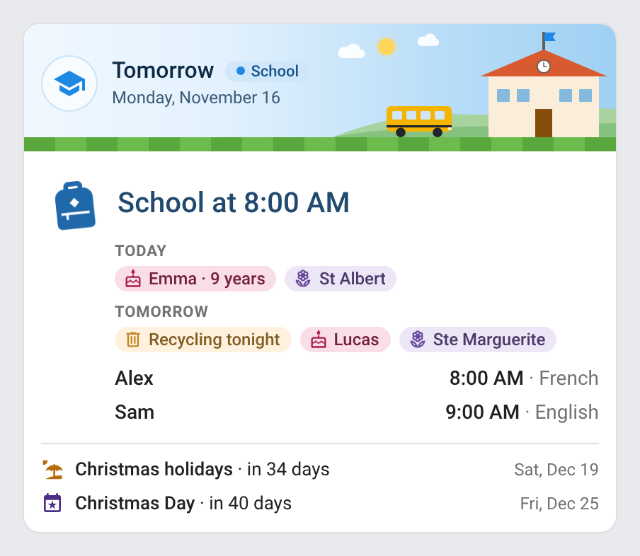 | 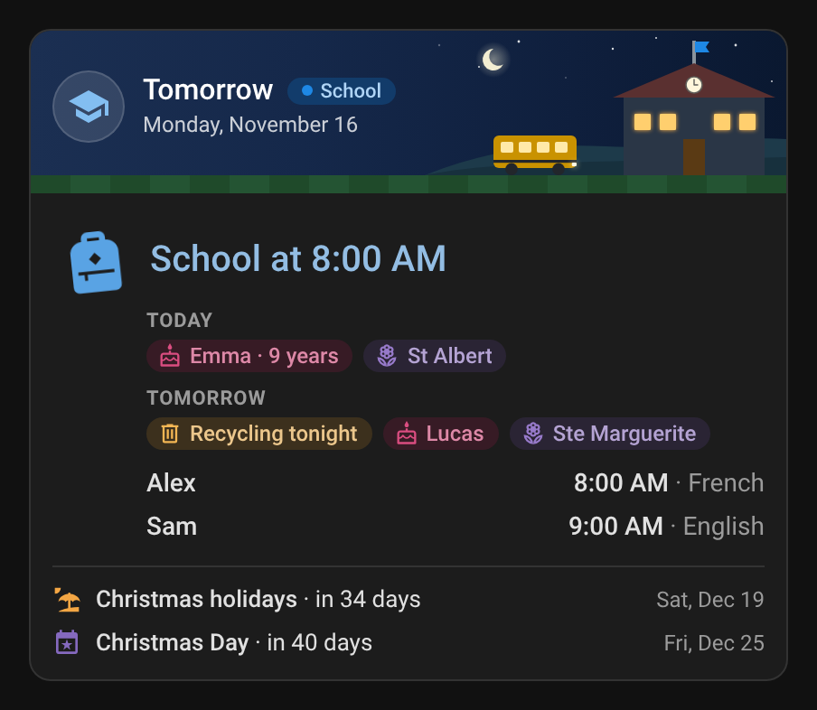 |
| 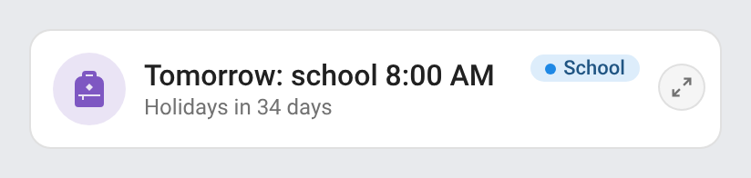 | 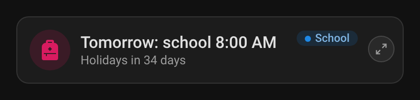 |

## Features

- Two cards: a full **Family Day Card** (`custom:family-day-card`) and a compact **Family Day Mini Card** (`custom:family-day-mini-card`)
- **Tomorrow first**: the header gives tomorrow's date and a status pill — **School**, **Weekend**, **Public holiday**, **Holidays** or **Day off** — and a big answer under it: **School at 8:00 AM** (the earliest first lesson of the children) or **No school — Christmas holidays**, **No school — Armistice Day**, **No school — Weekend**
- An **animated picture** of tomorrow: a swinging backpack, a turning sun, a beach umbrella over the waves, a party popper throwing confetti, a sofa for a day off; at midnight the old picture leaves and the new one bounces in (see [Animations](#animations))
- **One row per child** on a school day, from Pronote: the time of the first lesson and its subject (a cancelled lesson is skipped), **No lessons**, or **Timetable not known yet**
- **School holidays**: the next ones with a countdown (**Christmas holidays · in 34 days**), or, during the holidays, a progress bar with the day back at school (**back in 7 days**, day 10 of 16)
- **Next public holiday** with its date and countdown
- **Chips under the answer**: tomorrow's **bin collections** (**Recycling tonight**, tinted with the colour of the bin), **today's and tomorrow's birthdays** from a calendar (**Emma · 9 years**, **Lucas · tomorrow**) and, in French, **today's and tomorrow's name days** (**St Albert**, **Ste Marguerite · tomorrow**); each opens its calendar, and the mini card shows them under its header
- Mini card: one line for tomorrow (**Tomorrow: school 8:00 AM** / **No school tomorrow**), the holidays countdown under it and the pill; its **detail button** (top right) unfolds the full card, and a click anywhere outside the card folds it back
- Click the answer, a child or a line to open its source in Home Assistant (more-info dialog)
- Visual editor in the dashboard UI for both cards (the list of children stays in YAML)
- Sections view: the full card takes 12 columns by default and at least 6, the mini card 6; narrow widths get their own layout
- Light and dark mode, `prefers-reduced-motion`, English, French, German, Spanish, Italian, Dutch, European Portuguese, Polish, Serbian (Cyrillic and Latin), Romanian, Danish, Swedish, Bulgarian, Russian, Ukrainian, Hungarian, Slovak, Czech, Slovenian, Latvian and Greek
- Single file, no external dependency; the calendars are read once for all the cards of a page

## Supported integrations

| Integration | What the cards read |
|---|---|
|  [Workday](https://www.home-assistant.io/integrations/workday/) (core, `workday`) | Its binary sensor: the working days of the week (`workdays`), and whether tomorrow is a working day (the `workday.check_date` action, or the sensor's state with `days_offset: 1`) — a weekday it excludes (an added holiday, a bridge day) reads **Day off** |
|  [Remote calendar](https://www.home-assistant.io/integrations/remote_calendar/) (core, `remote_calendar`) | The school holidays calendar: the French education ministry's ICS of your zone ([Calendrier scolaire](https://data.education.gouv.fr/explore/dataset/fr-en-calendrier-scolaire/) on data.education.gouv.fr), or any calendar whose name says school holidays (`vacances`, `scolaire`, `school`, `Ferien`…) |
|  [Holiday](https://www.home-assistant.io/integrations/holiday/) (core, `holiday`) | The public holidays calendar of your country |
|  [Pronote](https://github.com/delphiki/hass-pronote) (custom, `pronote`) | The timetables of each child (one device per child): today's, tomorrow's and the next day's lessons, their start, subject and cancellation |
|  [Waste Collection Schedule](https://github.com/mampfes/hacs_waste_collection_schedule) (custom, `waste_collection_schedule`) | Its calendars: tomorrow's bin collections (any calendar named after the bins works too: `poubelle`, `déchets`, `collecte`, `waste`, `Müll`…) |
|  [Local calendar](https://www.home-assistant.io/integrations/local_calendar/) (core, `local_calendar`) or any calendar | The birthdays: a calendar whose name says birthdays (`anniversaires`, `birthdays`, `Geburtstage`…), one yearly event per birthday, with the birth year in it for the age |

None is required: without Workday, school days are Monday to Friday (or `school_days`); without a school holidays or public holidays calendar, its line and its kind of day are left out; without Pronote, the answer reads **School day** and there are no children's rows. The cards need at least one of them.

## Prerequisites

Home Assistant 2024.8 or later. For the French school holidays: add the **Remote calendar** integration with the ICS link of your zone (A, B, C, Corsica…) from the ministry's [Calendrier scolaire](https://data.education.gouv.fr/explore/dataset/fr-en-calendrier-scolaire/) dataset; for public holidays, the **Holiday** integration (country France); for days off, **Workday** (country France); for the timetables, the [Pronote](https://github.com/delphiki/hass-pronote) custom integration with one entry per child.

## Installation

### Via the Marketplace (recommended)

Click the button below to add the repository directly:

[](https://my.home-assistant.io/redirect/marketplace_repository/?owner=juju35&repository=ha-family-day-card&category=plugin)

Then click **Install**, and reload your browser when the Marketplace asks you to.

Or manually:

1. Open **Settings → Marketplace → Add from link** (top right; this needs a GitHub account connected)
2. Add `https://github.com/juju35/ha-family-day-card` — Type: **Dashboard**
3. Open **Family Day Card** and click **Install**
4. Clear your browser cache and refresh

The Marketplace adds the resource `/local/community/ha-family-day-card/family-day-card.js` for you.

### Manual

1. Download `family-day-card.js` and the `family-day-card.i18n.*.js` translation files from the [latest release](https://github.com/juju35/ha-family-day-card/releases/latest)
2. Copy them all to `/config/www/` (without the translation files, the cards show in English)
3. Go to **Settings → Dashboards → ⋮ → Resources** → Add resource:
   - URL: `/local/family-day-card.js`
   - Type: **JavaScript Module**
4. Clear your browser cache and refresh

## Configuration

### Card types

| Card | Type |
|---|---|
| Family Day Card | `custom:family-day-card` |
| Family Day Mini Card | `custom:family-day-mini-card` |

### Visual editor

Edit a dashboard, click **Add card** and search for **Family Day Card** or **Family Day Mini Card**. The Workday sensor and the calendars found are used without any setting; pick other ones if you have several, choose the school days, what is shown and the language. The preview updates live, and options left at their default are kept out of the generated YAML. The list of children (`children`) and the `ignore` pattern are YAML only.

### Minimal

```yaml
type: custom:family-day-card
```

```yaml
type: custom:family-day-mini-card
```

### Full options

```yaml
type: custom:family-day-card
title: Tomorrow
workday: binary_sensor.workday_sensor
school_holidays: calendar.vacances_scolaires
public_holidays: calendar.france
school_days:
  - mon
  - tue
  - thu
  - fri
children:
  - name: Alex
    tomorrow: sensor.pronote_martin_alex_tomorrow_s_timetable
    next_day: sensor.pronote_martin_alex_next_day_s_timetable
  - name: Sam
    tomorrow: sensor.pronote_martin_sam_tomorrow_s_timetable
ignore: "enseignant|prérentrée"
illustration: true
illustration_theme: auto
show_title: true
show_subtitle: true
show_children: true
show_holidays: true
show_public_holidays: true
waste: calendar.collecte_dechets
birthdays:
  - calendar.anniversaires
show_waste: true
show_birthdays: true
show_saint: true
language: fr
```

```yaml
type: custom:family-day-mini-card
show_countdown: true
zoom: true
language: fr
```

### Options reference

| Option | Card | Default | Description |
|---|---|---|---|
| `title` | both | Tomorrow | Card title (the mini card shows it in its detailed view) |
| `workday` | both | First Workday sensor | Binary sensor of the Workday integration; `false` to use none |
| `school_holidays` | both | First calendar named after school holidays | Calendar of the school holidays; `false` to use none |
| `public_holidays` | both | First Holiday calendar | Calendar of the public holidays; `false` to use none |
| `school_days` | both | Workday's days, else Monday to Friday | Days of the week with school (`mon` … `sun`), e.g. without Wednesday for a primary school |
| `children` | both | Pronote children found | **YAML only.** List of children: `name` and their Pronote timetable sensors `tomorrow` (tomorrow's timetable), and optionally `next_day` and `today`. Replaces the children found; `[]` hides them |
| `ignore` | both | `enseignant\|prérentrée\|teacher` | **YAML only.** Regular expression (case-insensitive) of school holidays events that are not holidays for the pupils, such as the teachers' pre-term day of the ministry's calendar; `""` keeps every event |
| `illustration` | both | `true` | Illustrated header: an animated 90 px banner showing what tomorrow is — the school and its bus (school day), the park and its swings (weekend), the beach on a sand strip (school holidays), the town hall with flags and fireworks (public holiday), a hammock (day off) — with the round icon coloured by tomorrow's kind of day. `false` brings back the classic header with its status pill |
| `illustration_theme` | both | `auto` | Day or night picture: `auto` follows `sun.sun` (else Home Assistant's dark mode), `day` or `night` forces it |
| `show_title` | both | `true` | Show the title in the header (e.g. `false` under a section heading of your own) |
| `show_subtitle` | both | `true` | Show tomorrow's date under the title |
| `show_children` | both | `true` | One row per child on a school day (Pronote) |
| `show_holidays` | both | `true` | School holidays line: the next ones with a countdown, or the current ones with their progress |
| `show_public_holidays` | both | `true` | Next public holiday line |
| `waste` | both | Bin calendars found | Calendar of the bin collections, or a list of them; `false` to use none |
| `birthdays` | both | Birthday calendars found | Calendar of the birthdays, or a list of them; `false` to use none |
| `show_waste` | both | `true` | Chip of each bin collected tomorrow (to put out tonight) |
| `show_birthdays` | both | `true` | Chip of each birthday of today and tomorrow |
| `show_saint` | both | `true` in French, else `false` | Chips of today's and tomorrow's name days, from the French calendar of saints |
| `show_today` | full | `false` | Split the full card into two sections — **Today** and **Tomorrow** — each with its short date, picture, answer, status pill and chips (bins under **Today**, birthdays and name days on their own day). **Tomorrow** keeps the children's rows |
| `extras` | both | `both` | Which day's chips to show: `both`, `today` or `tomorrow`. On the full card the two days are split into labelled **Today** / **Tomorrow** groups; the mini card keeps them in one row with a *· tomorrow* cue |
| `show_countdown` | mini | `true` | School holidays countdown under the mini card's answer |
| `zoom` | mini | `true` | Detail button at the top right of the mini card: it shows the full card (with the same options, so `show_children`, `show_holidays`… can be set on the mini card too, in YAML or in its visual editor) and switches back; a click outside the card also brings the compact view back. `false` removes the button |
| `language` | both | Auto | Force language: `en`, `fr`, `de`, `es`, `it`, `nl`, `pt`, `pl`, `sr`, `sr-Latn`, `ro`, `da`, `sv`, `bg`, `ru`, `uk`, `hu`, `sk`, `cs`, `sl`, `lv` or `el` (auto-detects from HA settings) |

## Screenshots

### Animations

The picture next to the answer plays one animation per kind of day; every animation honours `prefers-reduced-motion`.

A school day, the backpack swings:

| Light | Dark |
|---|---|
| 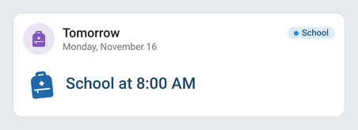 | 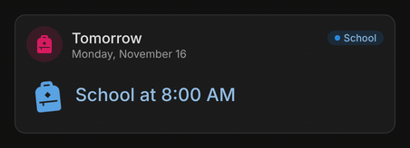 |

The weekend, the sun turns and glows:

| Dark | Light |
|---|---|
| 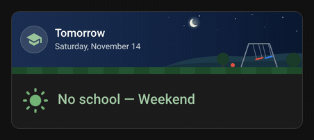 | 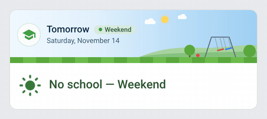 |

The school holidays, the beach umbrella sways over the waves:

| Light | Dark |
|---|---|
| 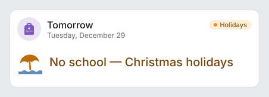 | 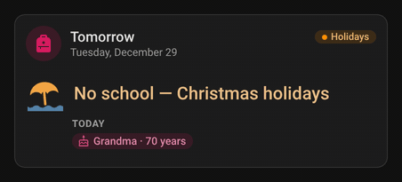 |

A public holiday, the party popper throws confetti:

| Dark | Light |
|---|---|
| 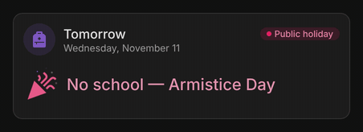 | 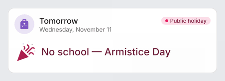 |

A day off for Workday, "z z" rise over the sofa:

| Light | Dark |
|---|---|
| 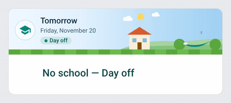 | 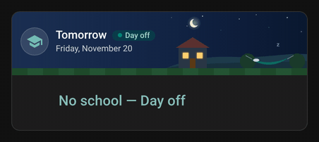 |

When tomorrow changes kind (at midnight, or when a calendar changes), the old picture leaves and the new one bounces in — here from the weekend to a school day:

| Dark | Light |
|---|---|
| 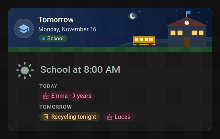 | 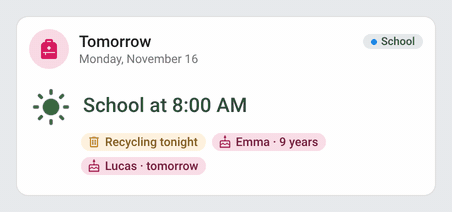 |

### Cards

Friday evening, the weekend tomorrow; the eve of a public holiday:

| | Weekend | Public holiday |
|---|---|---|
| Light | 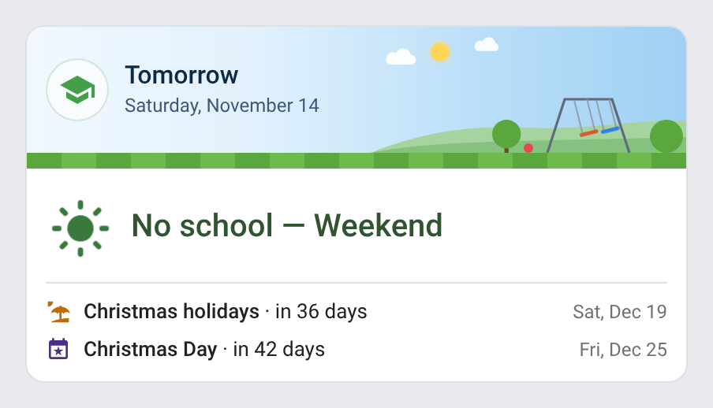 | 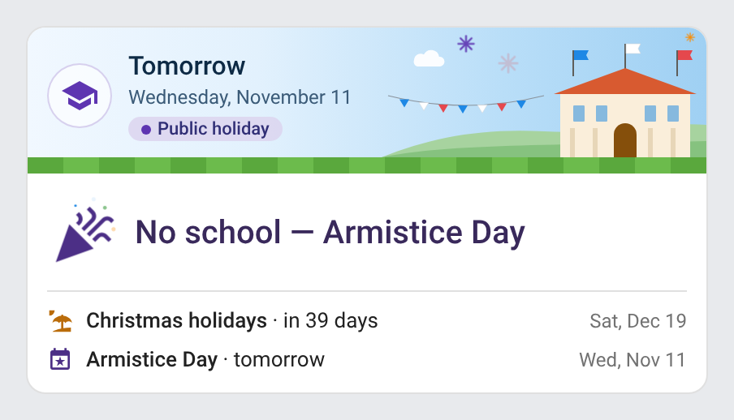 |
| Dark | 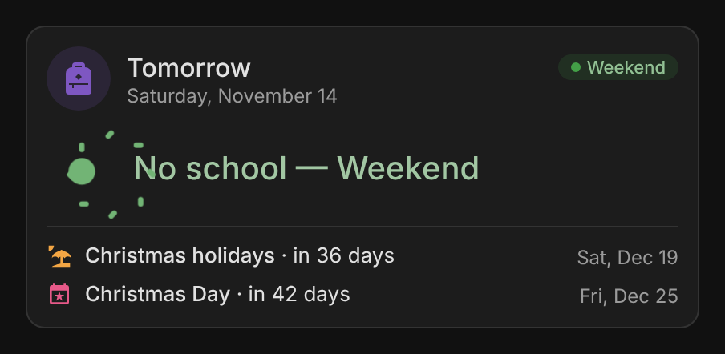 | 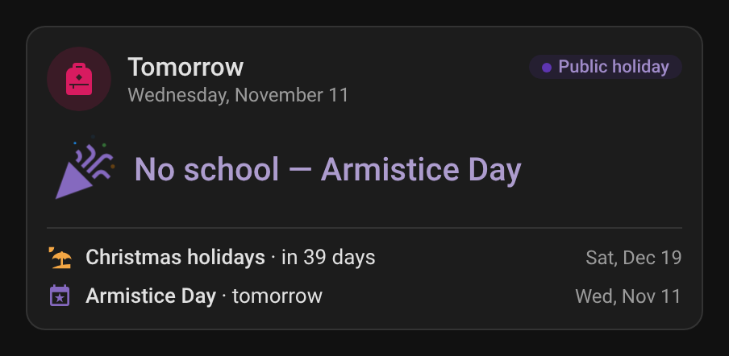 |

During the Christmas holidays: their progress and the day back at school, on the full card and on the mini card:

| | Full card | Mini card |
|---|---|---|
| Dark | 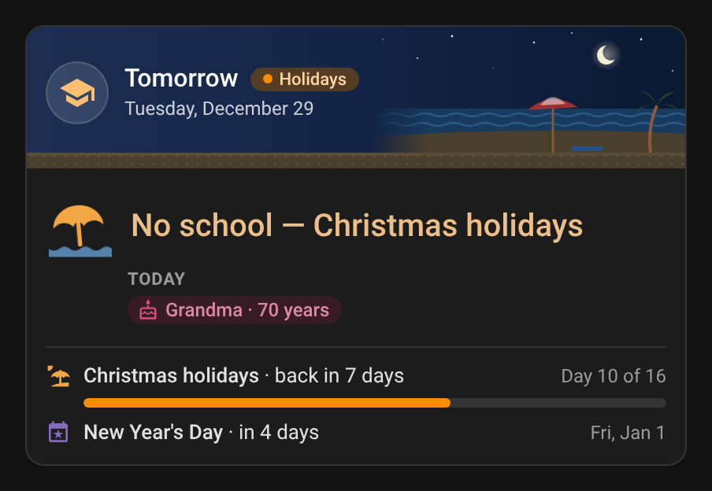 | 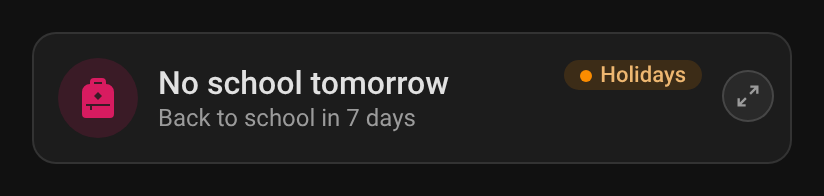 |
| Light | 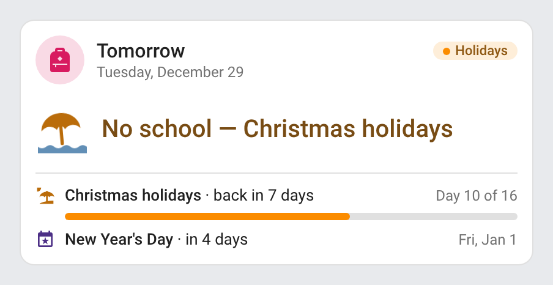 | 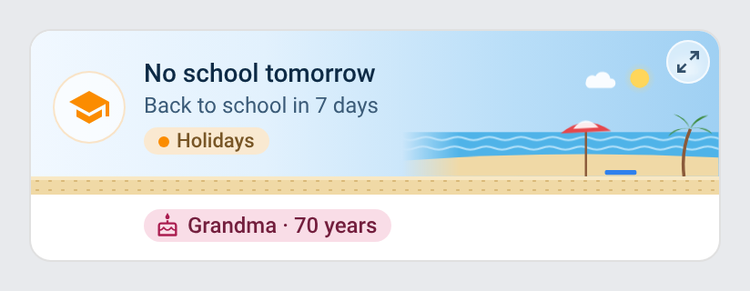 |

The mini card's detailed view, after a click on the detail button:

| Light | Dark |
|---|---|
| 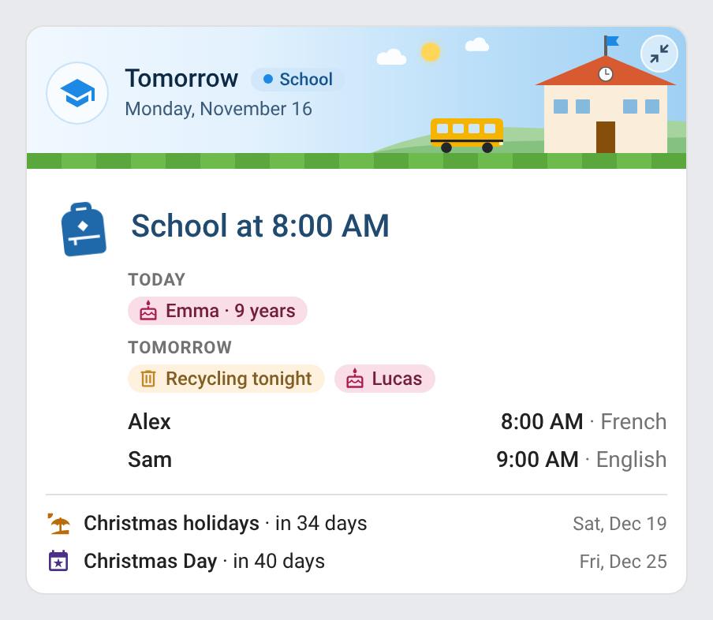 | 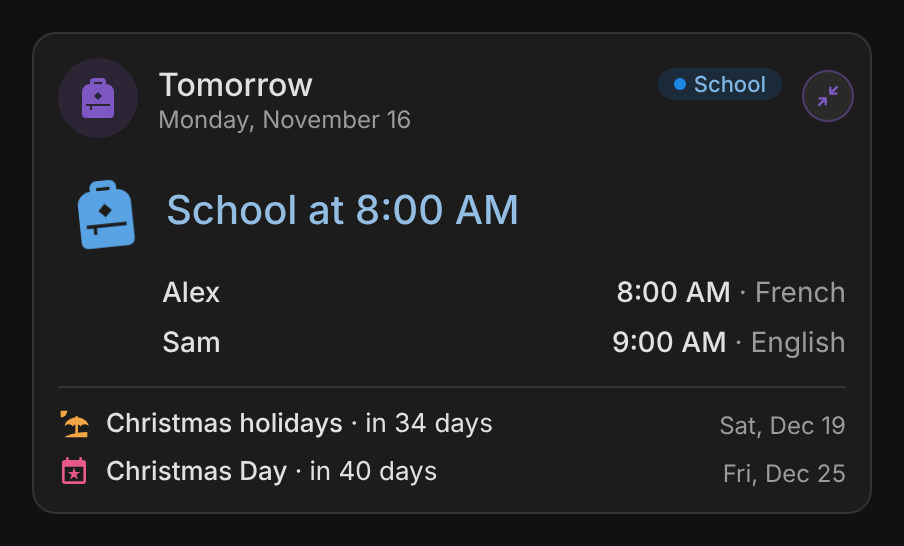 |

Narrow widths: the full card at 238 px (smaller answer, the dates of the lines give way) and the mini card at 170 px (the answer wraps, the pill gives way to it):

| | Full card | Mini card |
|---|---|---|
| Light | 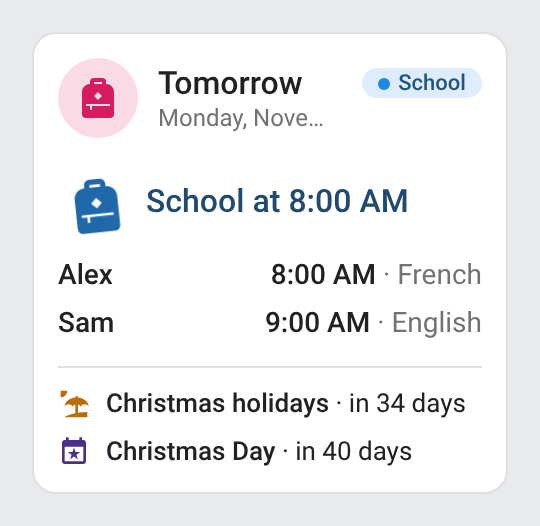 | 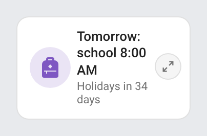 |
| Dark | 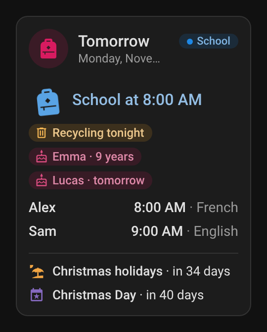 | 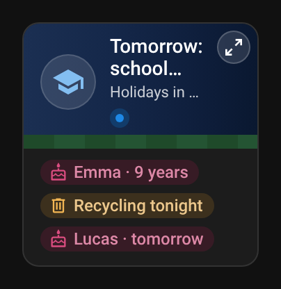 |

## How it works

The cards read the Home Assistant entity and device registries instead of entity ids: the first binary sensor of the `workday` integration, the first calendar of the `holiday` integration, the first other calendar whose id or name speaks of school holidays, and the Pronote timetable sensors (`lessons_today`, `lessons_tomorrow`, `lessons_next_day`) grouped by device, one device per child. A child's name is the device name without the `Pronote -` prefix and without the family name Pronote writes in capitals (`Pronote - MARTIN Alex` → `Alex`), or the name you gave the device.

### Tomorrow

Tomorrow is, in this order: a **public holiday** when the public holidays calendar has an event on that day; the **school holidays** when the school holidays calendar does (the longest event covering the day, the `ignore` events left out); the **weekend** when it is not a school day of the week (`school_days`, else Workday's `workdays`, else Monday to Friday); a **day off** when Workday says tomorrow is not a working day; else a **school day**. Days follow the time zone of your Home Assistant profile.

| Kind of day | Color |
|---|---|
| School | blue |
| Weekend | green |
| Public holiday | deep purple |
| Holidays | orange |
| Day off | teal |

The card's own badge (the backpack) keeps its rose accent whatever the day.

Workday is asked about tomorrow with its `workday.check_date` action (the answer is shared by all the cards of the page and kept 6 hours), unless its sensor is already about tomorrow (`days_offset: 1`), whose state is then read. While a calendar is loading, tomorrow reads **Loading…**; a calendar that fails to load is left out.

### First lessons

On a school day, each child's row reads the Pronote timetable that is about tomorrow (`tomorrow`, else `next_day` or `today` when their lessons fall on tomorrow): the start of the day (`day_start_at`, else the first lesson that is not cancelled) and the subject of the first lesson that takes place, in plain case (`MATHEMATIQUES` → `Mathematiques`). The answer gives the earliest first lesson among the children. A valid timetable without lessons reads **No lessons**; no timetable for tomorrow (Pronote not updated yet) reads **Timetable not known yet**.

### Holidays and public holidays

The calendars are read through the Home Assistant API for 100 days back and 400 days ahead, once for all the cards of the page, again every 6 hours, when the calendar's state changes and on the next day. The school holidays line shows the holidays going on today (their progress, day N of the total and the day back at school, which is the end of the event) or else the next ones with a countdown; the public holidays line shows the next public holiday from today on.

### Bins, birthdays and name day

The chips sit under the answer on the full card and under the header on the mini card, whatever tomorrow is; a chip opens its calendar.

- **Bins**: every event of the bin calendars that starts tomorrow, one chip per kind (**Recycling tonight**). Its colour comes from the words of its kind: yellow (packaging, `jaune`, `recycling`), blue (paper), brown (food and garden waste, `bio`), green (glass, `verre`), grey (household waste, `ordures ménagères`), else amber.
- **Birthdays**: the events of today and tomorrow of the birthday calendars, today's first. The name is the event's title without the birthday words (`Anniversaire de Léa`, `Léa's birthday` → `Léa`); a birth year in the title or the description (`née en 2017`) gives the age.
- **Name day**: today's and tomorrow's name days of the traditional French calendar (the *fêtes à souhaiter*), built into the card: **St Albert**, **Ste Marguerite**, or the feast (**Toussaint**). Its tooltip lists the saints of the day from the open data set [Les saints et fêtes du calendrier](https://www.data.gouv.fr/datasets/les-saints-et-fetes-du-calendrier) of data.gouv.fr (the liturgical saints, where the name day is often missing). It is on by default when the card speaks French.

On the full card the chips are split into a **Today** group and a **Tomorrow** group, each under its own label, so today's and tomorrow's information no longer mix. Set `extras: today` or `extras: tomorrow` to keep only one day (`both` by default). The bins are tomorrow's, so they only show when tomorrow is kept. The mini card keeps its chips in a single row, with a *· tomorrow* cue on tomorrow's.

### Today and tomorrow, side by side

Set `show_today: true` to give **today** its own block above **tomorrow**, instead of a single answer about tomorrow. Each section shows its short date, its picture, its *school / no school* answer with a status pill, and its chips: the bins to put out tonight sit under **Today**, while birthdays and name days stay on their own day. **Tomorrow** keeps each child's first lesson, and the school-holidays and public-holiday lines stay at the bottom of the card. The mini card is unchanged.

| Light | Dark |
| --- | --- |
| 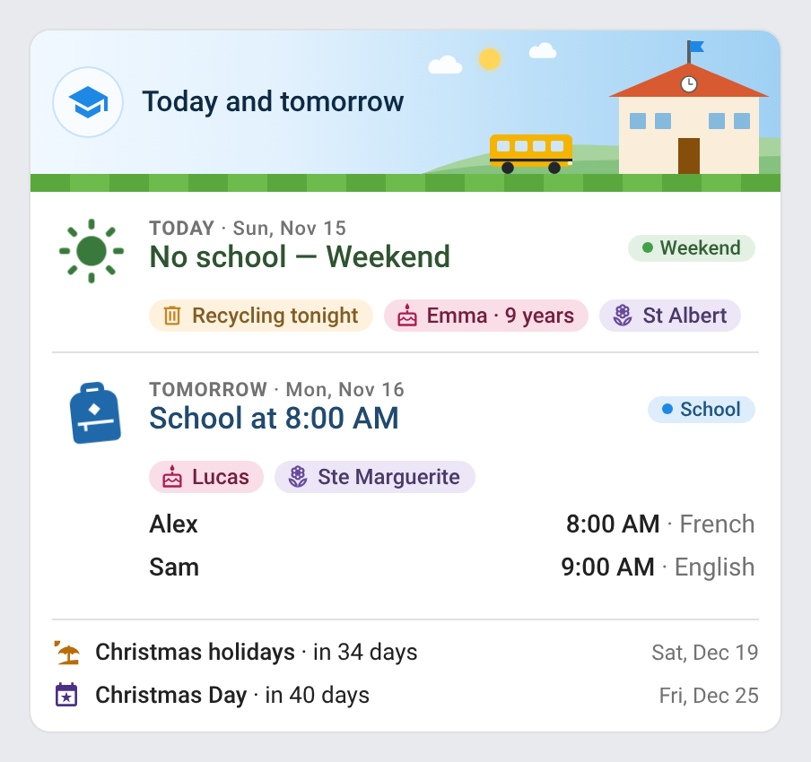 | 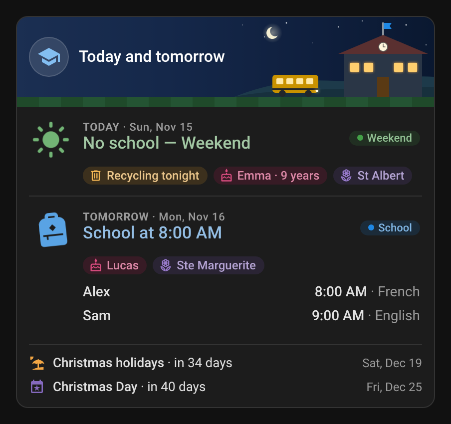 |

## Development

```bash
npm install
npm run build        # bundles src/family-day-card.js into dist/family-day-card.js (translations split into dist/family-day-card.i18n.*.js)
npm run check        # builds and checks the card (run in CI)
npm test             # unit tests (node --test)
npm run screenshots  # renders the cards (and one GIF per animation, needs ffmpeg) with mock data into screenshots/
```

`dist/` is not committed: `npm run build` creates it locally, CI builds it on every push, and the release workflow attaches the built files to the release, which is where the Marketplace installs it from. The **Screenshots** workflow re-renders the captures on every pull request that touches the card and commits them to the pull request's branch when a pixel changed.

### Releasing

1. Bump `version` in `package.json` (and `package-lock.json` with `npm install`)
2. Add a `## <version>` section at the top of [CHANGELOG.md](https://github.com/juju35/ha-family-day-card/blob/main/CHANGELOG.md)
3. Push to `main`: the **Release** workflow builds the card, creates the tag and the GitHub release with the changelog section as notes, and attaches `family-day-card.js` and its translation files

## Translations

The cards auto-detect the language from your Home Assistant settings. Currently supported:

| Language | Code |
|---|---|
| English | `en` |
| Français | `fr` |
| Deutsch | `de` |
| Español | `es` |
| Italiano | `it` |
| Nederlands | `nl` |
| Português (European; also used for `pt-BR`) | `pt` |
| Polski | `pl` |
| Српски | `sr` |
| Srpski (latinica) | `sr-Latn` |
| Română | `ro` |
| Dansk | `da` |
| Svenska | `sv` |
| Български | `bg` |
| Русский | `ru` |
| Українська | `uk` |
| Magyar | `hu` |
| Slovenčina | `sk` |
| Čeština | `cs` |
| Slovenščina | `sl` |
| Latviešu | `lv` |
| Ελληνικά | `el` |

The names of the holidays come from your calendars, in their own language. Contributions for additional languages are welcome!

## Credits

The Pronote logo comes from the [Home Assistant brands](https://github.com/home-assistant/brands) repository; Pronote is a trademark of Index Éducation. The Workday, Holiday, Remote calendar and Local calendar pictures are their Material Design Icons; the Waste Collection Schedule logo comes from its [repository](https://github.com/mampfes/hacs_waste_collection_schedule). This project is not affiliated with Index Éducation, the hass-pronote project or the French Ministry of Education.

## Data

The saints listed in the tooltip of the name day chip come from [Les saints et fêtes du calendrier](https://www.data.gouv.fr/datasets/les-saints-et-fetes-du-calendrier) (data.gouv.fr), under the [Licence Ouverte / Open Licence](https://www.etalab.gouv.fr/licence-ouverte-open-licence/), version of 2024-09-07, with May and June put back in place, accents and typos fixed and the days' saints reordered.

## License

[MIT](https://github.com/juju35/ha-family-day-card/blob/main/LICENSE)

## Support

If you find this project useful, you can support its development:

<a href="https://buymeacoffee.com/julienstep9"></a>
